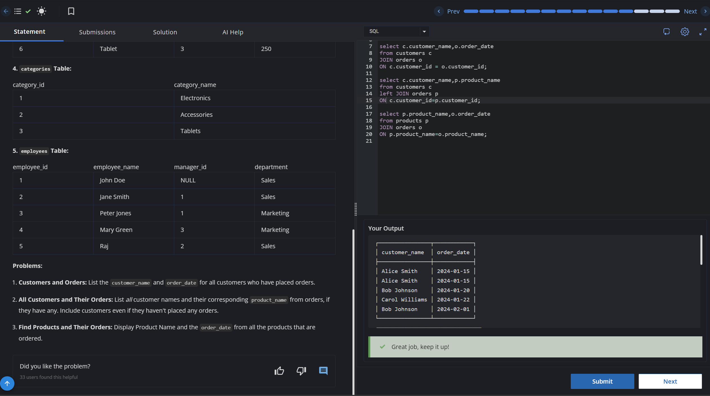

# Experiment 4 - Task 1

Name: ABHINEET

UID: 24BCS10039

## Aim

To retrieve customer names and their order dates for customers who have placed orders.

## Question

Write a query to join the customers and orders tables using the customer_id column and display the customer name along with the order date.

## SQL Queries Used

```sql
select c.customer_name,o.order_date
from customers c
JOIN orders o
ON c.customer_id = o.customer_id;
```

## Output

```text
The query returns the matching records from the customers and orders tables.
```

## Output Screenshot



## Image Explanation

The screenshot shows the SQL join query executed in the SQL editor, and the result contains the matching customer and order records returned by the INNER JOIN.

## Result

The required customer-order details were retrieved successfully using a join query.
