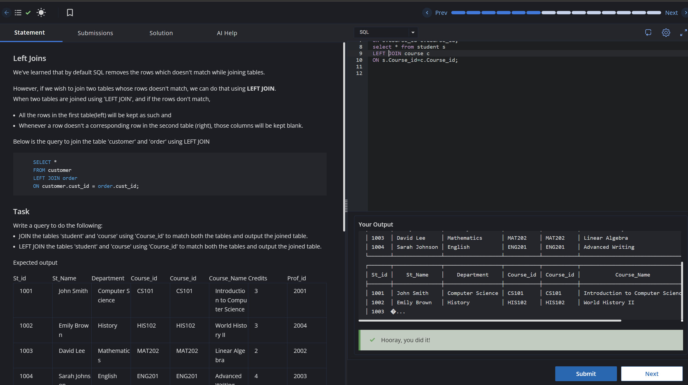

# Experiment 4 - Task 2

Name: ABHINEET

UID: 24BCS10039

## Aim

To list all customers and their corresponding product names, including customers who have not placed any orders.

## Question

Write a query to display customer names and product names using a LEFT JOIN so that customers without orders are still included.

## SQL Queries Used

```sql
select c.customer_name,p.product_name
from customers c 
left JOIN orders p
ON c.customer_id=p.customer_id;
```

## Output

```text
The query returns all customers and shows product names where an order exists; otherwise, the product name remains empty.
```

## Output Screenshot



## Image Explanation

The screenshot shows the LEFT JOIN query and the output where every customer is preserved while product names appear only for matching order records.

## Result

The customer list was retrieved successfully while preserving customers who had no orders.
