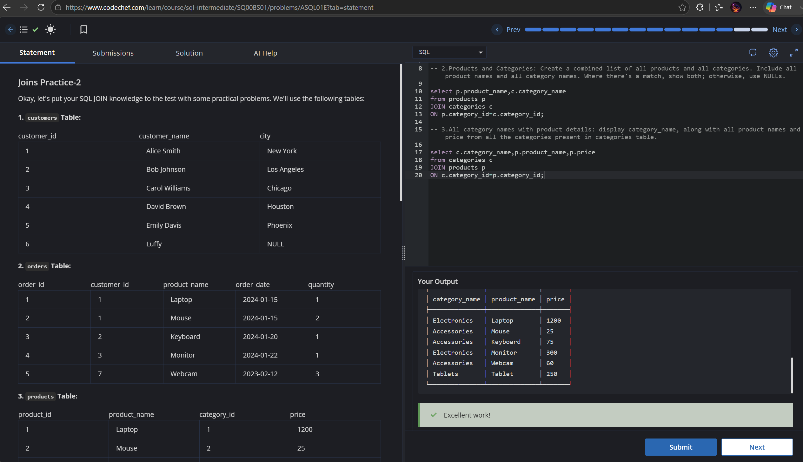

# Experiment 4 - Task 3

Name: ABHINEET

UID: 24BCS10039

## Aim

To display product names along with their order dates from the products and orders tables.

## Question

Write a query to join the products and orders tables and show the product name together with the order date.

## SQL Queries Used

```sql
select p.product_name,o.order_date
from products p
JOIN orders o 
ON p.product_name=o.product_name;
```

## Output

```text
The query returns the products that appear in orders along with their corresponding order dates.
```

## Output Screenshot



## Image Explanation

The screenshot shows the join between products and orders, and the output lists the product names with their corresponding order dates.

## Result

The product and order information was retrieved successfully through a join operation.
