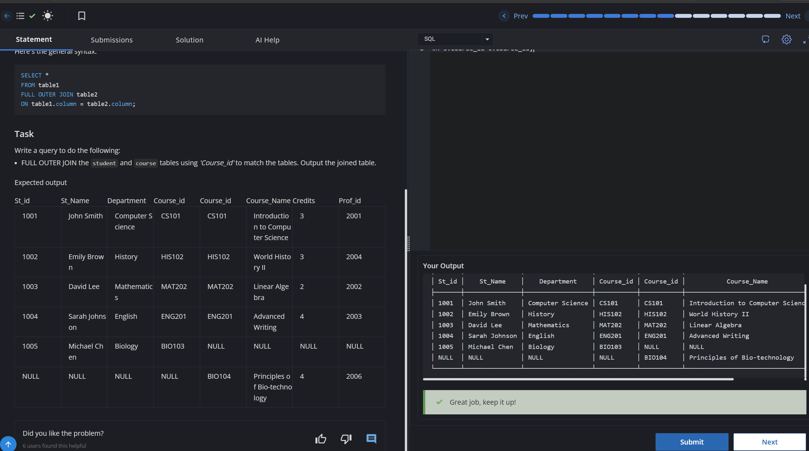

# Experiment 4 - Task 4

Name: ABHINEET

UID: 24BCS10039

## Aim

To join the student and course tables using the Course_id column.

## Question

Write a query to perform an INNER JOIN between the student and course tables and display the combined result.

## SQL Queries Used

```sql
select * from student s
JOIN course c
ON s.Course_id=c.Course_id;
```

## Output

```text
The query returns the matching rows from student and course where the Course_id values are equal.
```

## Output Screenshot



## Image Explanation

The screenshot shows the student-course INNER JOIN query and the resulting rows where the Course_id values match in both tables.

## Result

The student-course join was completed successfully and the related records were displayed.
