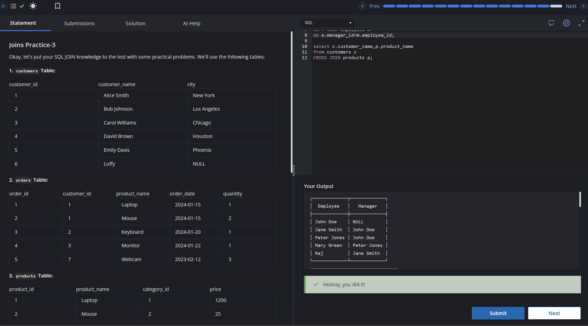

# Experiment 4 - Task 5

Name: ABHINEET

UID: 24BCS10039

## Aim

To join the student and course tables using LEFT JOIN so that all student records are retained.

## Question

Write a query to perform a LEFT JOIN between student and course using Course_id and display the result.

## SQL Queries Used

```sql
select * from student s
LEFT JOIN course c
ON s.Course_id=c.Course_id;
```

## Output

```text
The query returns all students and shows matching course details where available.
```

## Output Screenshot



## Image Explanation

The screenshot shows the LEFT JOIN output, where all student records are preserved and any unmatched course information appears as NULL.

## Result

The LEFT JOIN query was executed successfully and all student records were displayed along with their related course data where present.
