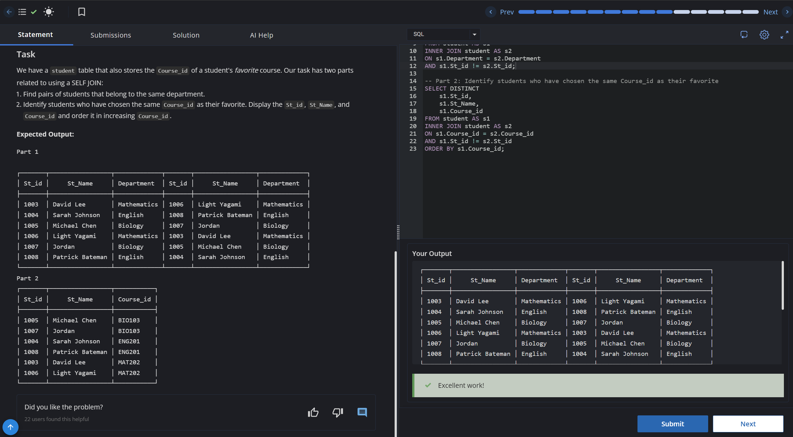

# Experiment 4 - Task 6

Name: ABHINEET

UID: 24BCS10039

## Aim

To retrieve all orders together with the corresponding customer details.

## Question

Write a query to join the customers and orders tables and display all order details along with the customer name.

## SQL Queries Used

```sql
select c.customer_name,o.order_id,o.customer_id,o.product_name,o.order_date,o.quantity
from customers c
JOIN orders o 
ON c.customer_id=o.customer_id;
```

## Output

```text
The query returns each order with the related customer information.
```

## Output Screenshot



## Image Explanation

The screenshot shows the order and customer join query executed successfully, returning each order alongside the related customer information.

## Result

The orders and customer details were retrieved successfully through the join query.
